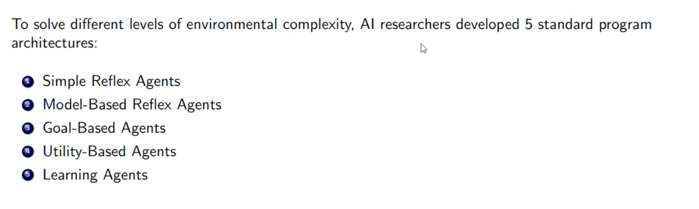
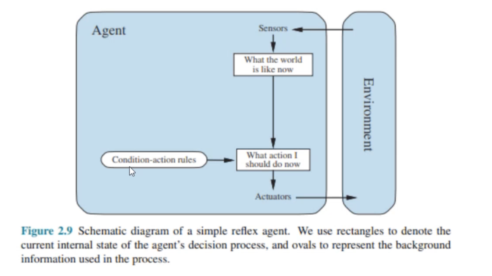
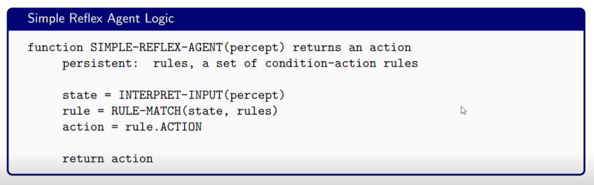
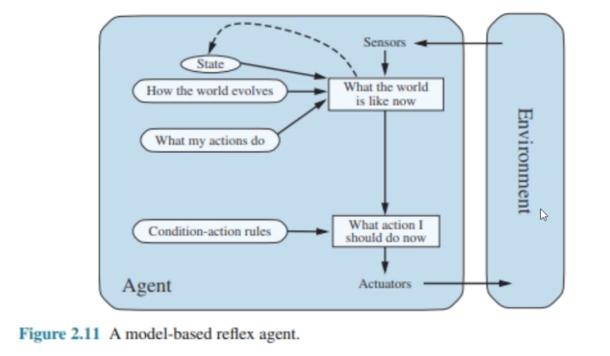
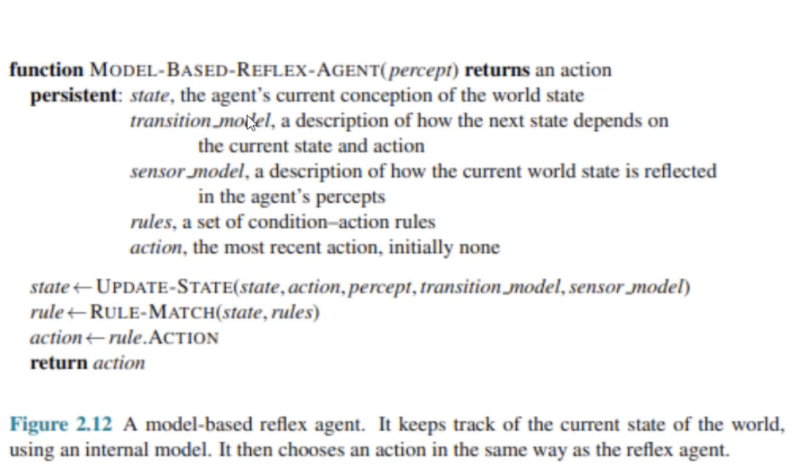
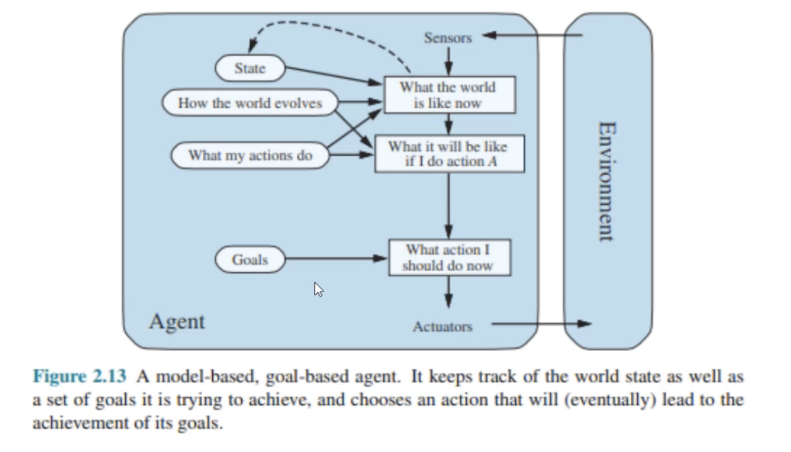
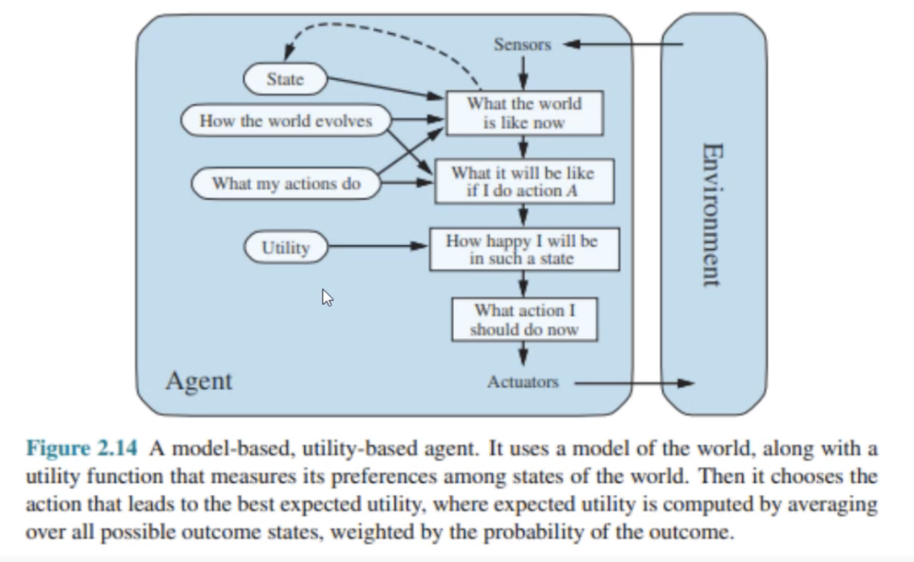
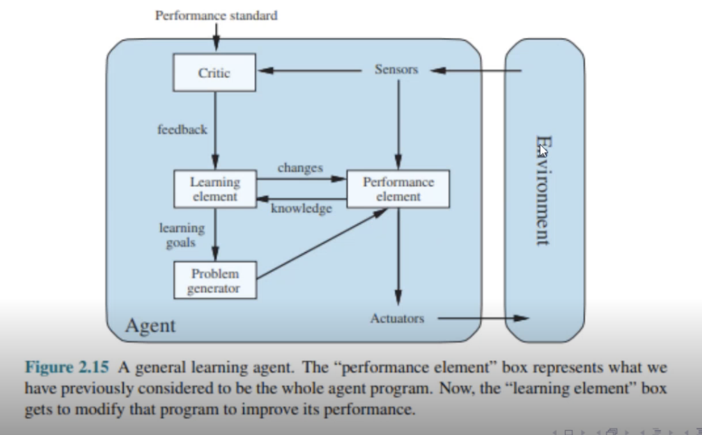

# Agent Architectures Types



<br/>

## Simple Reflex Agents



- The most fundamental and basic architecture.
- **Definition**: `These agents select actions based only on the current percept, completely ignoring the rest of the percept history`
- They have absolutely zero memory.

<br/>

- **Core Machanism**: `Conditon-Action Rules`
- Behaviors are dictated by Condition-Action Rules (also known as IF-THEN rules).
- IF (car in front is braking) THEN (initiate braking).
- Human equivalent: Blinking when an object flies toward your eye. You do not consciously plan this; it is a raw reflex mapped directly from sensor to actuator.

<br/>

- In partially observable environments, a simple reflex agent often falls into unavoidable infinite loops.
- Example: A vacuum robot that only has a "DIRT" sensor, but no "LOCATION" sensor.
- If it hits a clean square, the rule says "Move Right". If it hits a wall on the right, it might bounce back to the clean square, triggering "Move Right" again. Forever.

<br/>

**Usages**

- `Smart Thermostats`: IF temp > 24C, THEN turn on AC. No complex memory required.
<br/>
- `Basic Web Scrapers`: IF page contains target HTML tag, THEN extract text.
<br/>
- `Why use them?` They are incredibly fast. Lowest possible latency because calculation time is near zero.

<br>

**Implementation**



**Limitations**

- What if you are driving, you check your mirror, and see a car in your blind spot.
- You look straight ahead again (the car is now out of your sensor view).
- A simple reflex agent would instantly change lanes and crash, because its current percept is "Clear Road". It forgot the car existed

<br/>

## Model based Reflex Agents



- **Definition**: Agents that maintain an internal state that tracks aspects of the environment that are not currently visible.
- They build a "Model" of the world in their memory.
- This is the most effective foundational way to handle Partially Observable environments.

<br/>

To update an internal state accurately, the agent needs two distinct types of programmed knowledge:

- **The Transition Model**: How the world evolves independently of the agent (e.g., "The car in my blind spot is moving at 60 km/h, so it will stay there for 3 seconds").
- **The Sensor Model**: How the agent's own actions affect the world (e.g., "If I turn the steering wheel 10 degrees, my car shifts 1 meter left").

<br/>

**Implementation**



**Usage**

Here is the text from the image converted into Markdown format:

- **Anti-Lock Braking Systems (ABS)**: The car remembers the rotational speed of the wheel from a millisecond ago to determine if it is currently locking up.

- **Advanced Vacuum Robots**: High-end Roomba models that build an internal 2D grid map of your living room, remembering where walls are so they do not clean the same spot twice.

**Limitations**

- A model-based agent knows exactly what the world looks like.
- But knowing what is happening is not enough to decide what to do.
- Example: A self-driving car knows it is at an intersection. Should it go left, right, or straight? The model cannot answer this without a destination.

<br/>

## Goal based Agents



- **Definition**: Agents that combine a world model with Goal Information that describes desirable situations.

```
goal-based agents replace fixed condition-action rules with a desired target or objective
```

- They project into the future using Search and Planning algorithms (e.g., Breadth-First Search, A*).
- They constantly ask: "What will happen if I do action X? Will that bring me closer to my goal state?"

<br/>

- `Reflex Agents`: Fast, but brittle. If it rains, you have to rewrite all the hardcoded driving rules.
- `Goal Agents`: Slower (because they must compute future paths), but incredibly flexible.   If a road is closed, a goal-based agent simply re-runs its search algorithm to find a new path to the goal.

- You do not have to reprogram its brain.

<br/>

**Usages**

- **GPS Navigation (Google Maps)**: The app uses current state (traffic data) and a goal (destination coordinates) to calculate a route path via search algorithms.   
- **Automated Warehouse Pathfinding**: Amazon Kiva robots constantly re-plan their routes to target shelves if another robot suddenly blocks their way.

**Limitations**

- Goals are strictly binary: You either achieved the goal, or you didn't.
- What if there are 10 different paths to the goal? A goal-based agent sees them all as perfectly equal
- But in reality, one path might be faster, safer, or consume less fuel. We need a way to measure quality.

<br/>

## Utility based Agents



- Agents that use a Utility Function to map a state (or sequence of states) to a real number.
- This number represents the "happiness" or "desirability" of that state.
- The agent's objective is to choose the action that maximizes the Expected Utility.

<br/>

- In a deterministic environment, the agent knows exactly what state its action will lead to.
- In a stochastic environment, an action leads to a probability distribution of outcomes.
- Expected Utility Formulation: The agent calculates the utility of each possible outcome, multiplies it by the probability of that outcome occurring, and sums them up.

<br/>

**Usages**

- **Algorithmic High-Frequency Trading**: An agent cannot guarantee a stock will go up (highly stochastic). It maximizes expected utility by weighing potential profit against downside risk parameters.

- **Autonomous Taxis**: Balancing ETA (time utility), fuel efficiency (cost utility), and passenger comfort (smooth braking utility).

**Limitations**

- All previous architectures rely on the human programmer to define the models, rules, goals, and utility functions in advance.
- What if the environment changes over time?
- What if the environment is completely unknown initially?

<br/>

## Learning based Agents



<br/>

This has 4 main elements

- **Performance Element**: The core operational engine that selects and executes actions based on current inputs.

- **Critic**: Evaluates the success of the agent's actions against an objective external standard and provides feedback.

- **Learning Element**: Analyzes the critic's feedback and updates the agent's internal rules or models to improve future performance.

- **Problem Generator**: Suggests new, exploratory actions to help the agent discover better strategies rather than just sticking to known paths.

<br/>

**Usages**

- **Spam Filters**: They learn new spammer tactics over time based on user feedback (Critic = User clicking "Mark as Spam").

- **Large Language Models (LLMs)**: Trained via Reinforcement Learning from Human Feedback (RLHF), adapting their generation weights based on what human critics score highly.
