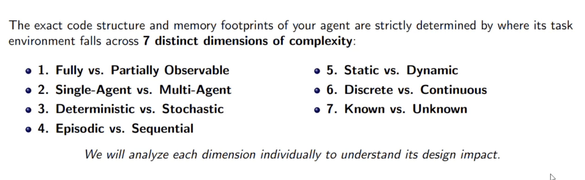
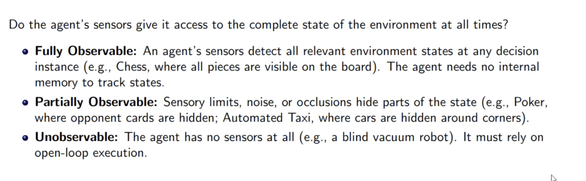
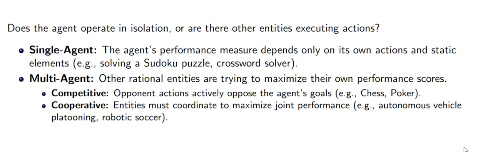
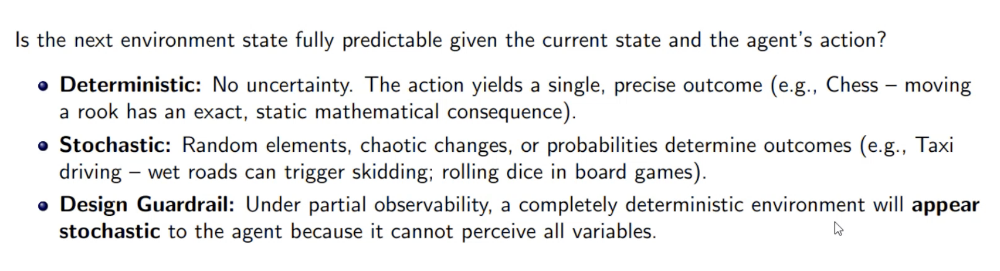
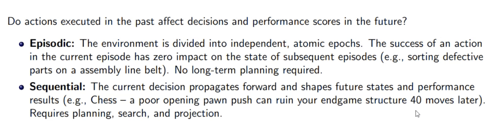
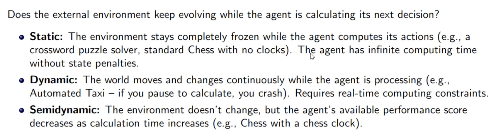
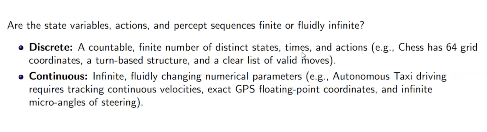
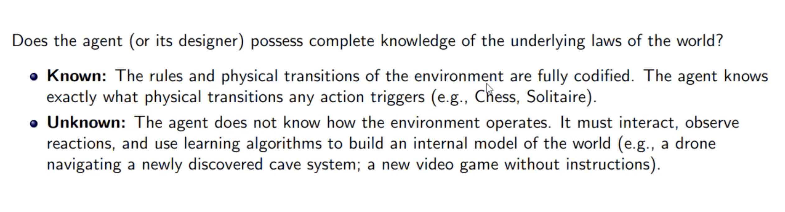

# Environment Architectures Types

- An environment is everything in the world which surrounds the agent, but it is not a part of an agent itself.
- An environment can be described as a situation in which an agent is present.

 

## Environmental Complexity

 

