# Introduction to Intelligent Agents

- Study about `Rational Agents` and it's `Environment`
- Agents can sense the environments

 

## What is an Agent?

An AI Agent is `an autonomous software system that can perceive its environment, make plans, and execute multi-step actions to achieve a specific goal`

Unlike a standard chatbot that only replies with text, an AI agent takes real-world actions like running code, calling software application programming interfaces (APIs), or browsing the web. [1] (https://www.youtube.com/shorts/EtfauX_axA4), [2] (https://www.youtube.com/watch?v=ZvDkJsKE80k&t=13)

 

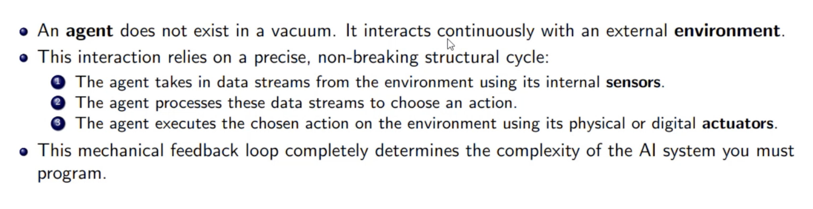

 

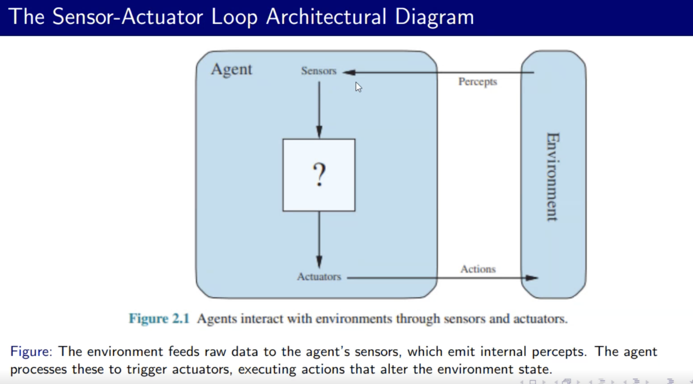

 

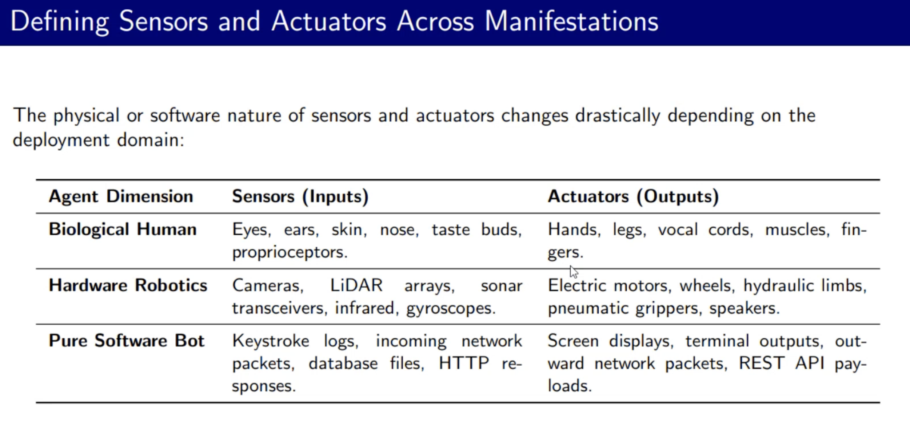

 

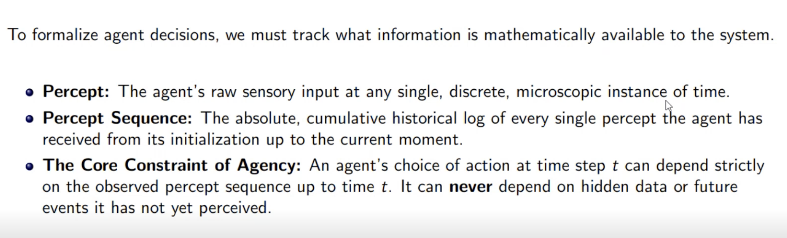

 

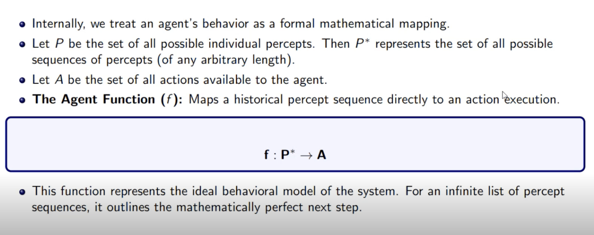

### 🧩 Symbol Breakdown

* **\(f\) (Agent Function):** This represents the internal logic, algorithm, or brain of the AI agent. It defines how the agent maps its inputs to its outputs.
* **\(P^*\) (Percept Sequence):** 
  * \(P\) stands for a single **percept** (the data the agent receives from its environment via sensors at any given moment).
  * The asterisk (\(^*\)) is the Kleene star, meaning a **sequence** or history. 
  * Therefore, \(P^*\) represents the entire history of everything the agent has perceived from its very first moment up to the current time.
* **\(\rightarrow\) (Maps to):** This indicates a mathematical mapping or transformation from the input side to the output side.
* **\(A\) (Action):** This represents the set of all possible **actions** the agent can take in its environment using its actuators.

 

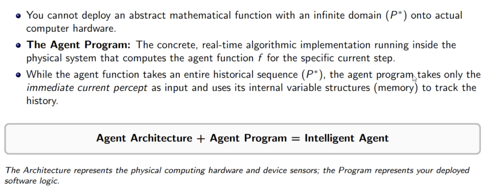

 

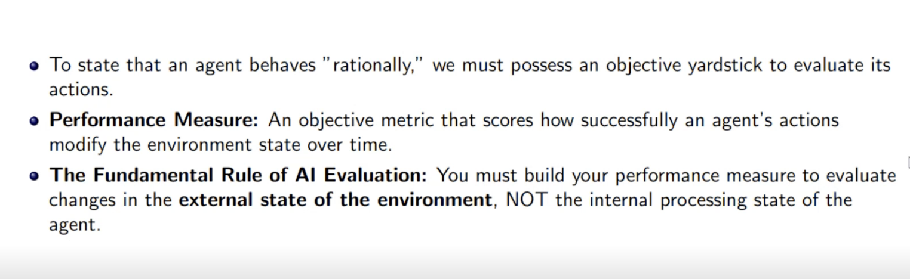

 

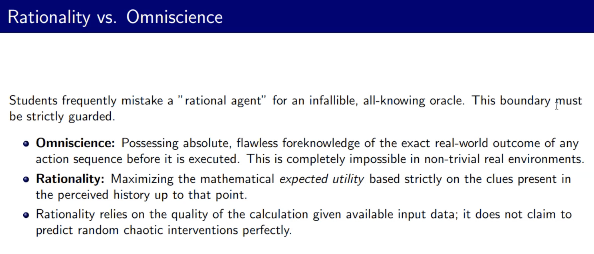
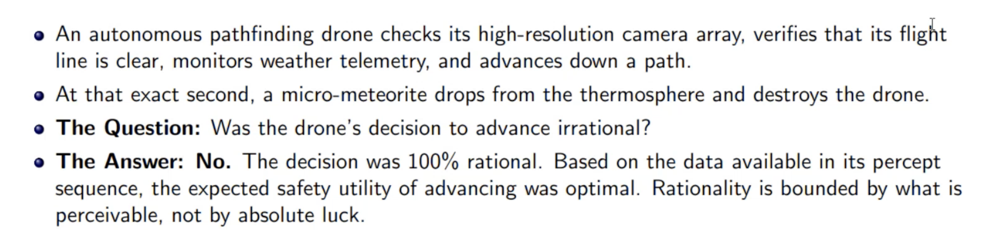

 

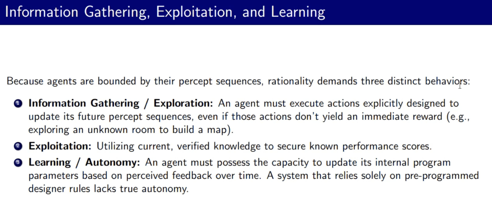

 

## PEAS Framework

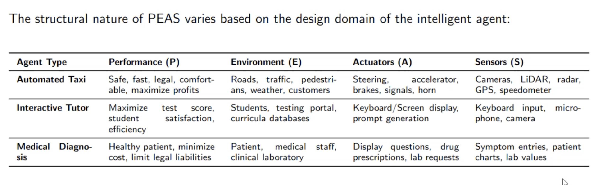
