# Constraint Satisfaction

`Constraints` - Rules & Protocols
`Satisfaction` - Apply consttraints properly

- It is a problem in Artificial Intelligence where we need to assign values to a set of variables while satisfying a set of constraints (rules).

- Goal is to find an assignment of values to all variables such that every constraint is satisfied.

 

## Why should know?

- Formulate real-world problems as Constraint Satisfaction Problems (CSPs).
- Contrast CSPs with standard pathfinding search (A∗).
- Trace the execution of Backtracking Search.
- Optimize search spaces using Heuristics (MRV, Degree, LCV).
- Apply Constraint Propagation techniques (Forward Checking, AC-3).
- Exploit problem structure (Tree-structured CSPs) to reduce time complexity.

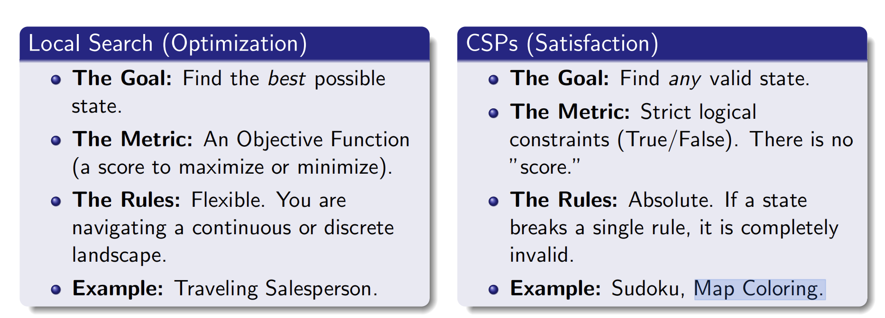

 

## Components

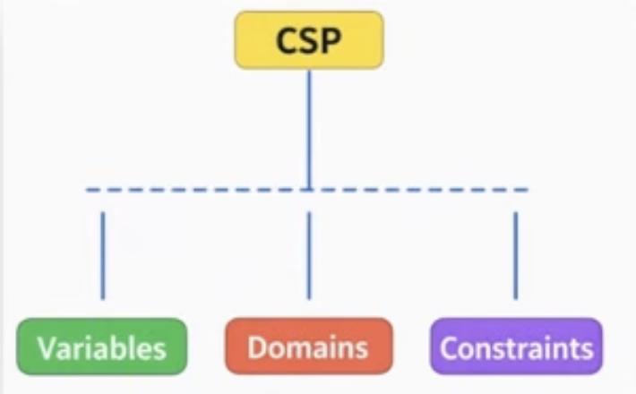

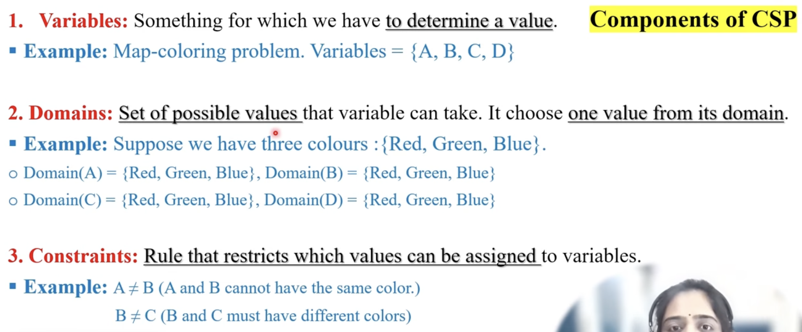

 

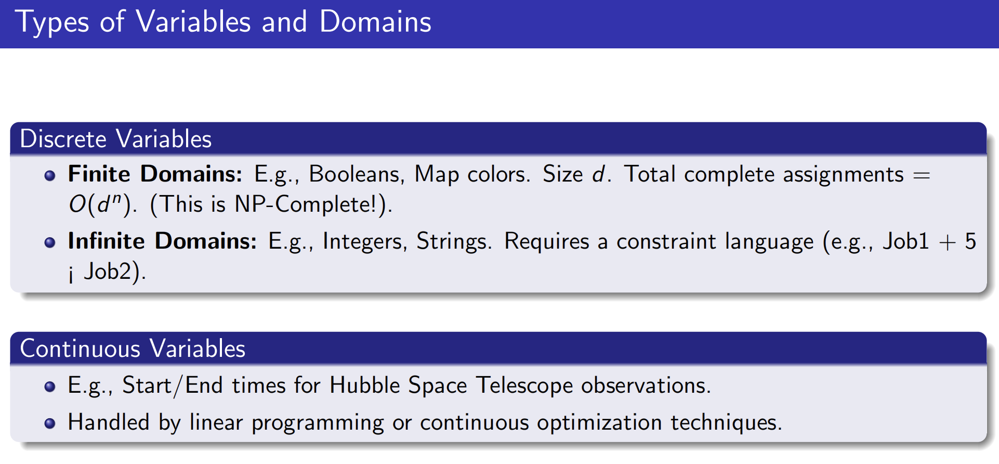

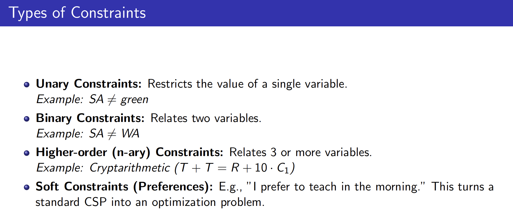

 

## Examples

These all have set of rules and all the things follows those rules
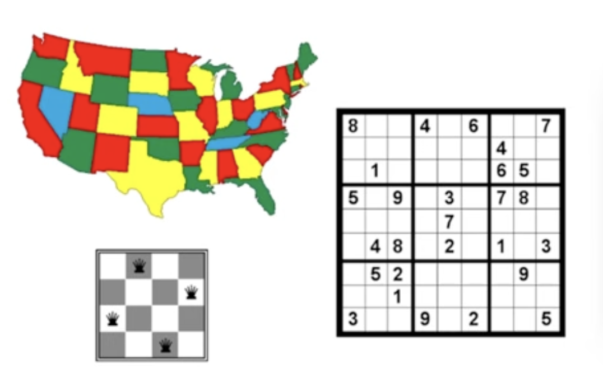

Exam Problem
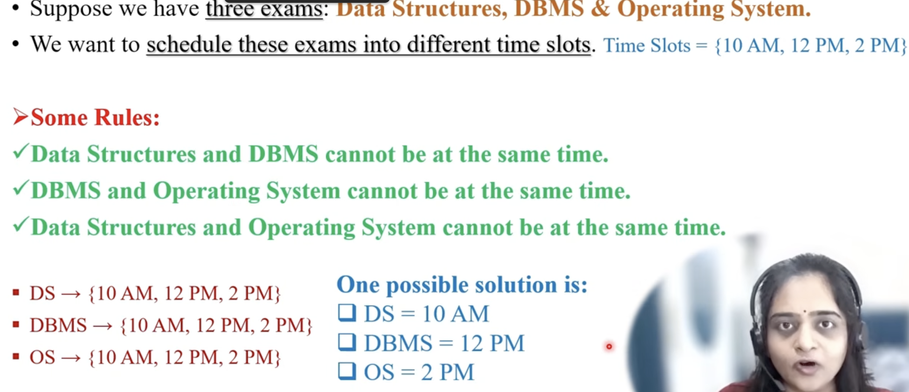

 

Map Coloring Problem
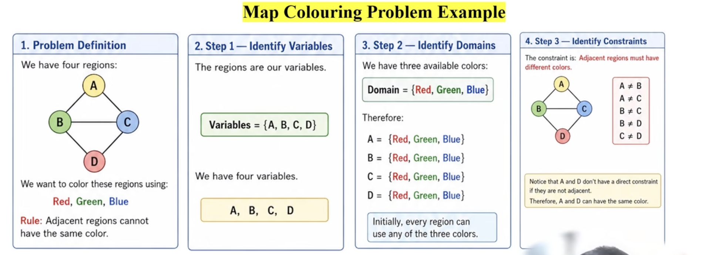
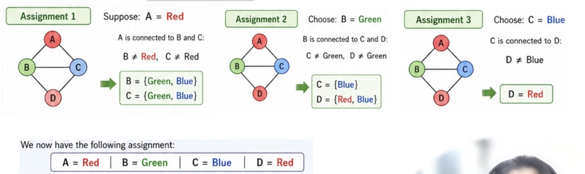
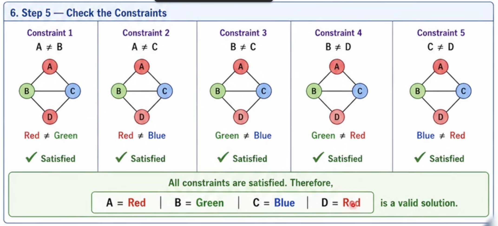

---

Cryptarithmetic / Send More Money Problem
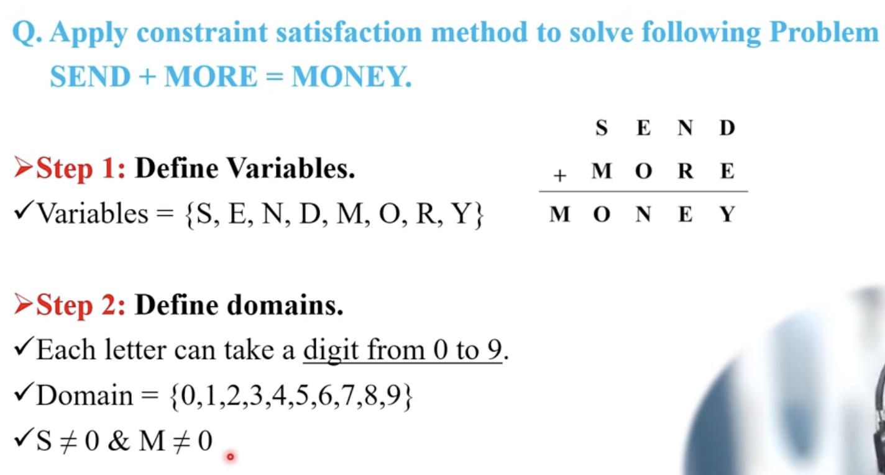
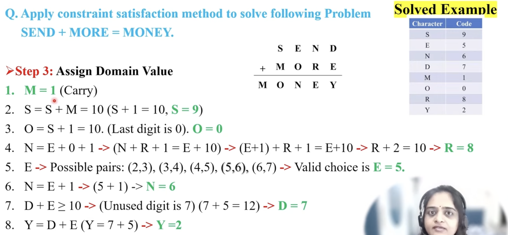

 

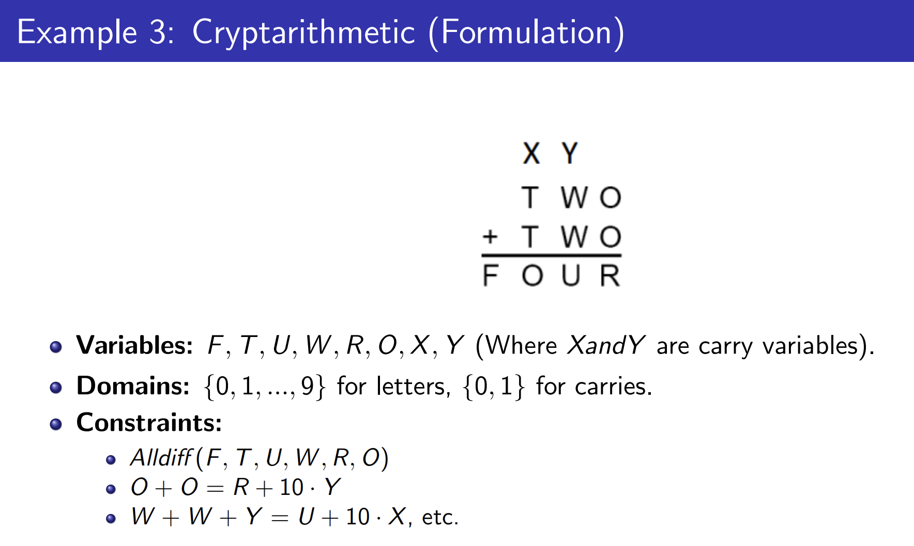

 

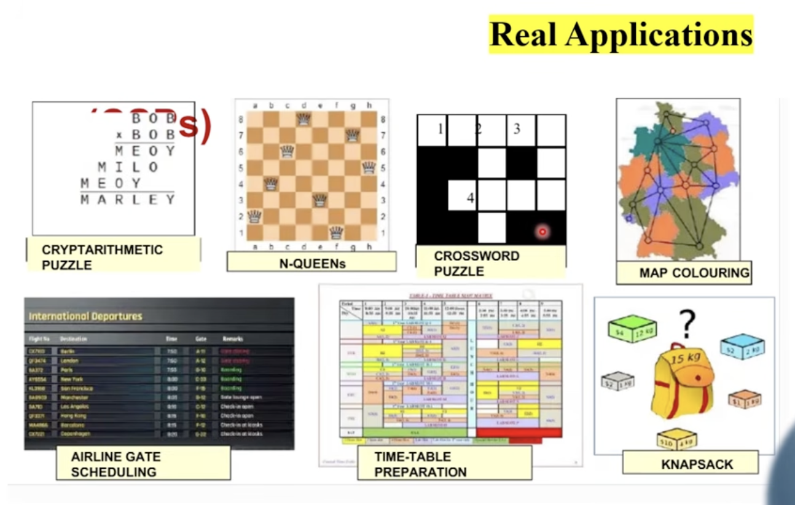

 

## Modern CS

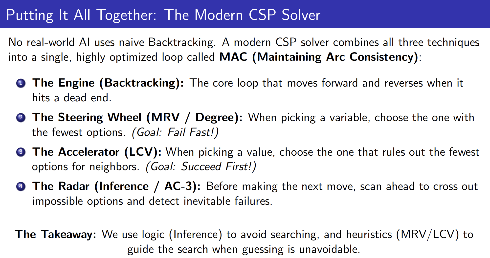
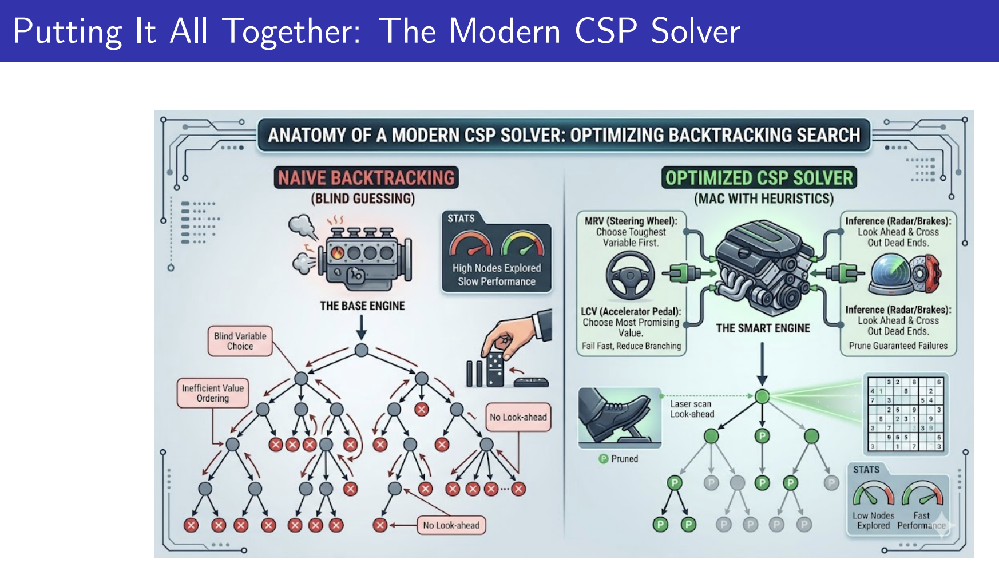
