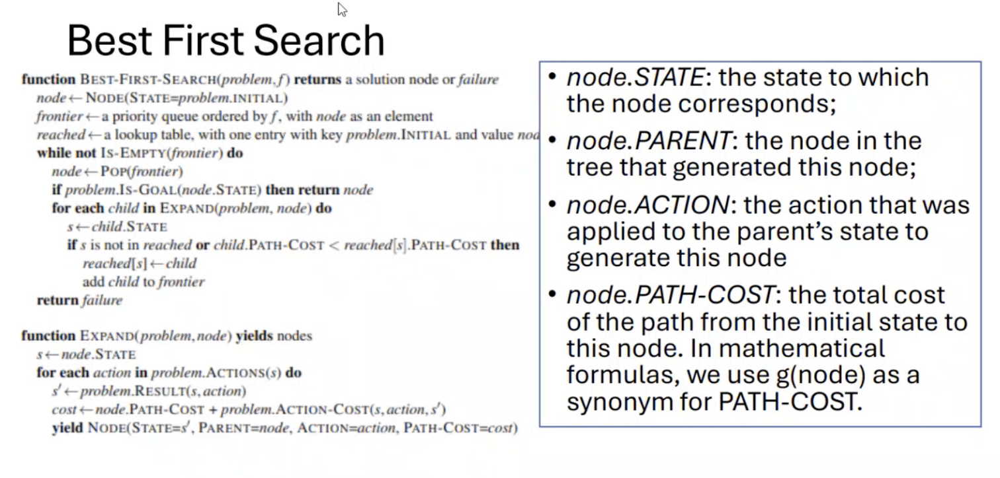
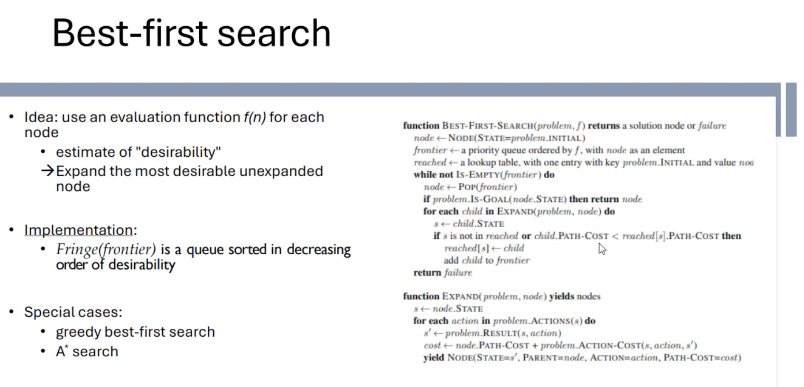
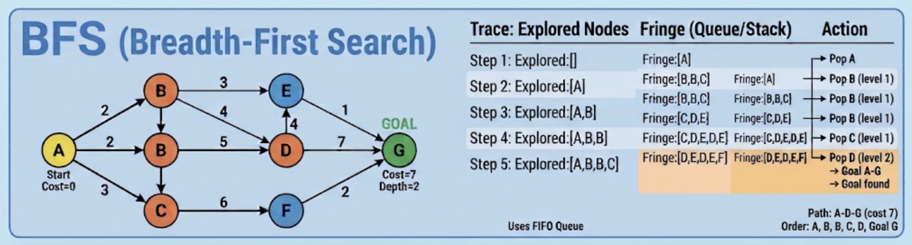

# Breadth-First-Search | BFS




---

- `Strategy`: Expands the shallowest unexpanded node first. It systematically explores the graph level by level.

<br/>

- `Data Structure`: FIFO Queue (First-In, First-Out).

<br/>

## Properties

- `Complete`: Yes (if branching factor $b$ is finite).

- `Optimal`: Yes, if all step costs are identical (e.g., unit cost).

- `Time Complexity`: $O(b^d)$ (where $b$ is the branching factor and $d$ is depth of the shallowest goal).

- `Space Complexity`: $O(b^d)$ (keeps every generated node in memory).

---

```cmd
graph TD
    A((1: Start)) --> B((2: Level 1))
    A --> C((3: Level 1))
    B --> D((4: Level 2))
    B --> E((5: Level 2))
    C --> F((6: Level 2))
    C --> G((7: Level 2))
    
    classDef visited fill:#e1f5fe,stroke:#01579b,stroke-width:2px;
    class A,B,C,D,E,F,G visited;
```

<br/>

Order of traversal: Explores nodes row-by-row (1 $\rightarrow$ 2 $\rightarrow$ 3 $\rightarrow$ 4 $\rightarrow$ 5 $\rightarrow$ 6 $\rightarrow$ 7).

---

## Example


<br/>


