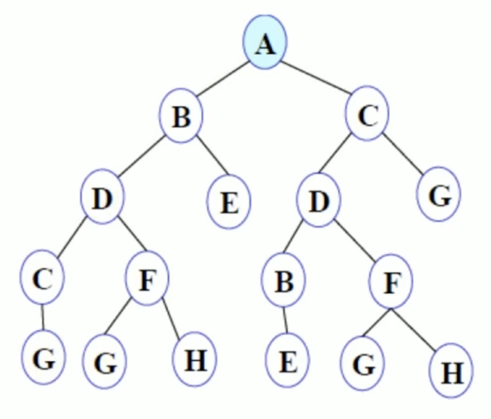
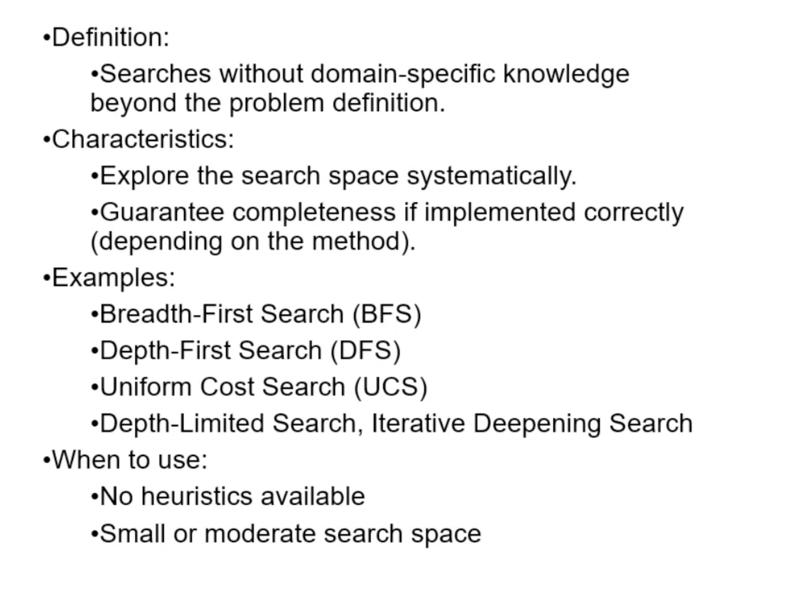

# Uninformed Search / Blind Search

 

- Try to go in every path and find the best path to get the final goal state
- These are brute force search algorythms
- It doesnt use information about the problem to guide search
- Not very efficient
- Take long time to achieve

 

## Key evaluation criteria:

- `Completeness`: Does it always find a solution if one exists?

- `Time Complexity`: How long does it take to find a solution?

- `Space Complexity`: How much memory is required?

- `Optimality`: Does it find the lowest-cost/shortest path?

 

## Algorythms

- [Breadth-First-Search | BFS](./bfs.md)
- [Depth-First-Search | DFS](./dfs.md)
- [Uniform-Cost-Search | UCS](./ucs.md)
- [Depth-Limited-Search | DLS](./dls.md)
- Iterative Deeping Depth First Search
- Bidirectional Search
