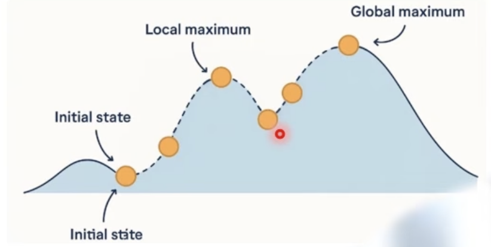
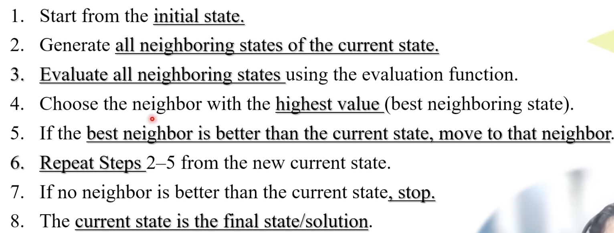
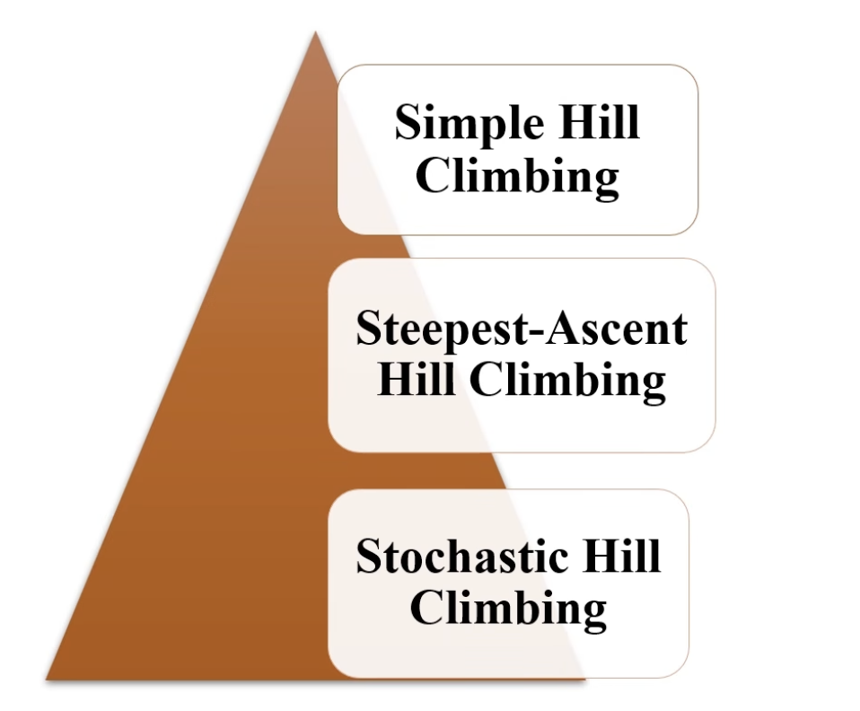
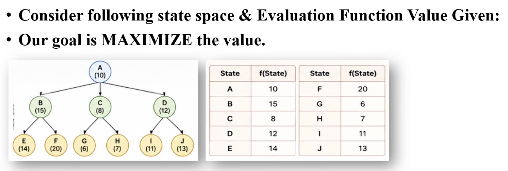
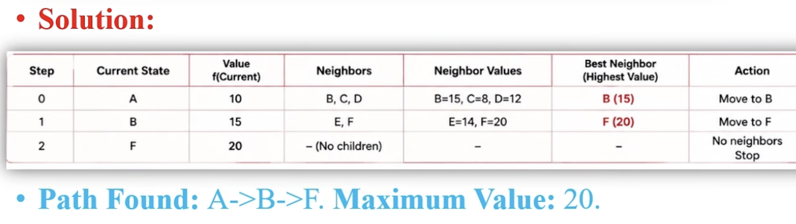

# Hill Climbing Search

- It is a local search optimization algorithm.
- It continuously moves from current state to a neighboring state with a better evaluation value.
- Always try to search the maximun value / state (`because try to go to high value on the hill`)
- Explore one value at a time

 

- `Local Maximum`: It is better than its immediate neighboring states.
- `Global Maximum`: It represents the best possible solution in the entire search space.
 
- `Example`: 
  - Climbing a hill to reach the top.   
  - You look around   
  - Choose the path that goes upward   Keep moving upward   
  - Stop when there is no higher path / reach the goal.  

 

 

## Types

 

## Example

