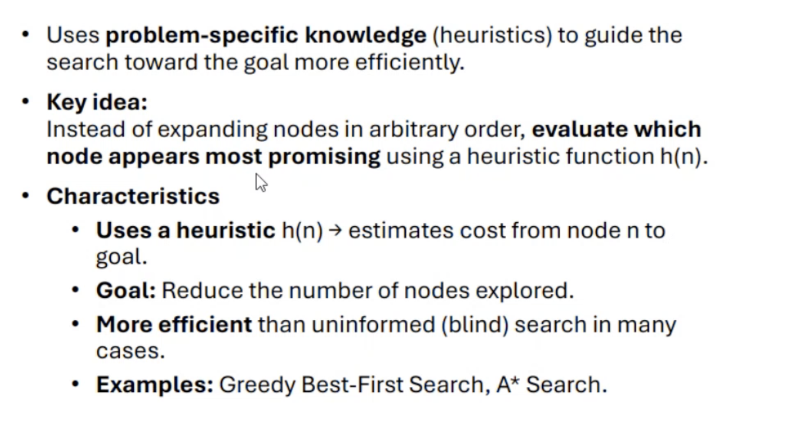
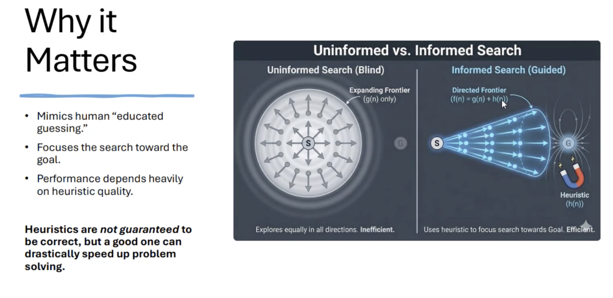
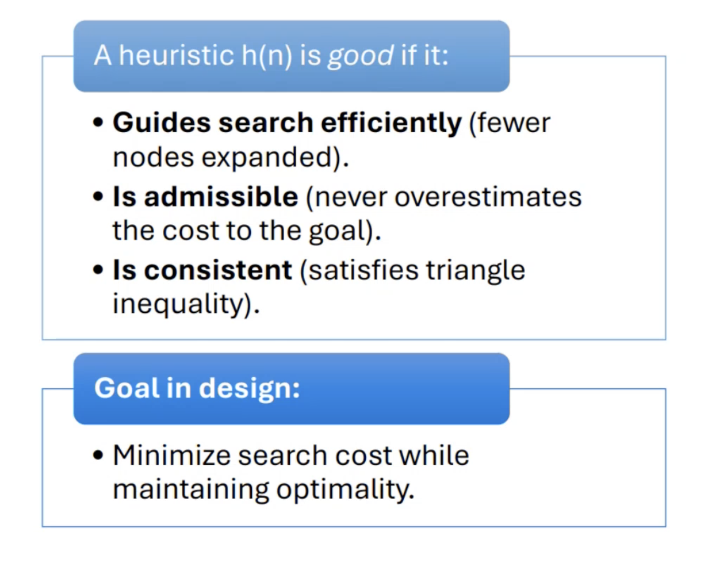
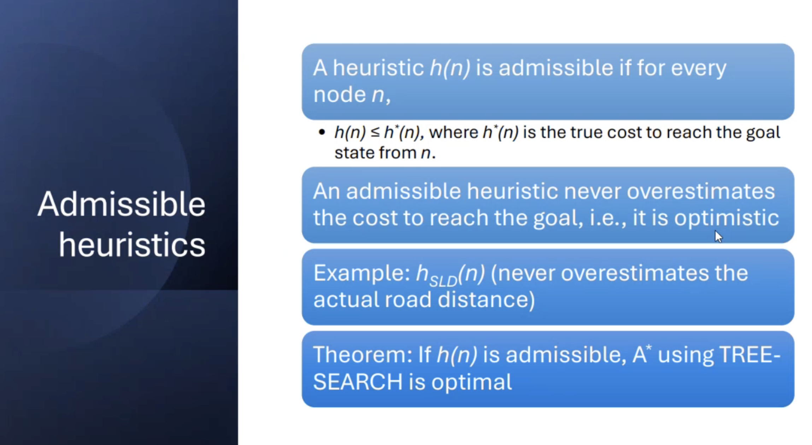
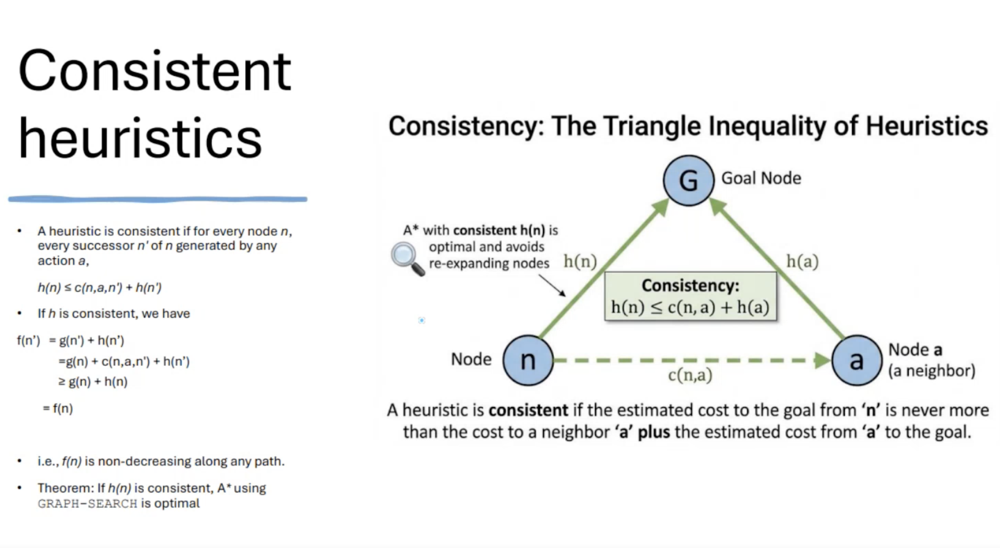
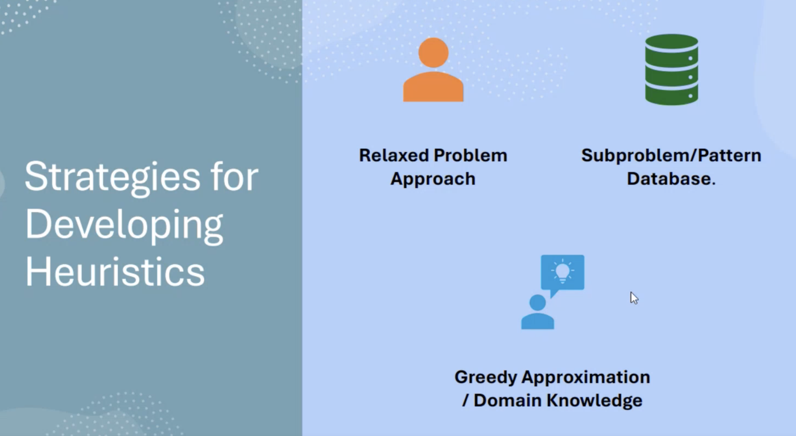
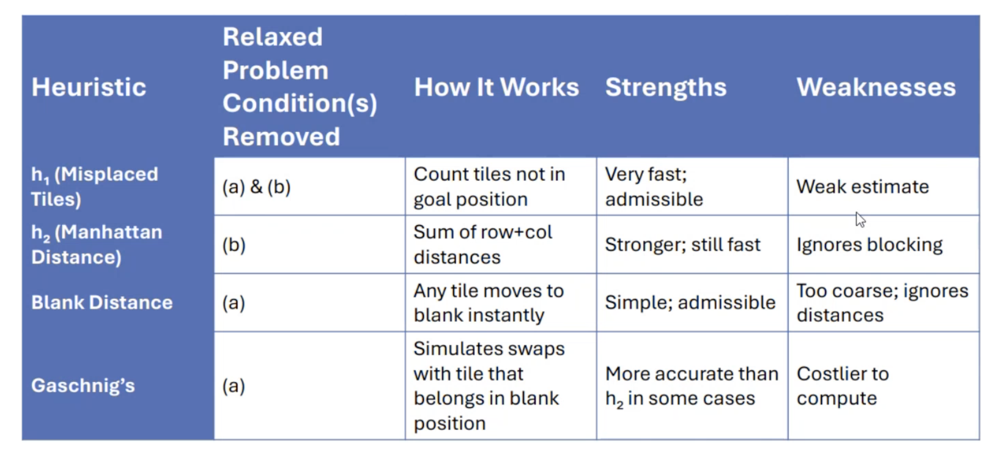
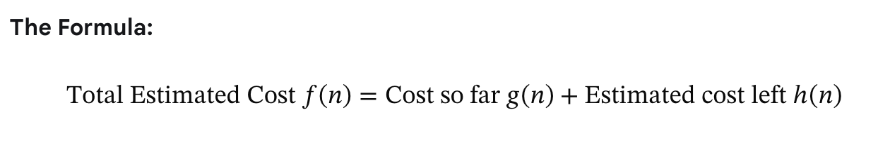
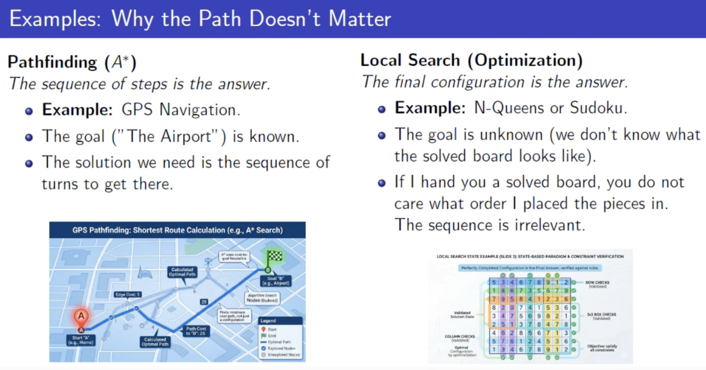

# Informed Search / Hueristic Search

- It uses information about the problem to guide search
- Guess the distant to goal state
- Very efficient
- Take less time to achieve
- Search may not always possible

 

## Key Concepts

- **Heuristic function h(n)**: An estimate of the remaining cost or distance from the current node n to the goal. For example, straight-line distance or Manhattan distance.
- **Path cost g(n)**: The actual cost incurred from the start node to the current node n.
- **Evaluation function f(n)**: A combined score used to decide which node to expand next.

 

### Path Cost: \(g(n)\) — The Past

• `What it is`: The actual, exact cost it took to travel from the starting point to your current position (node \(n\)).
• `GPS Analogy`: The number of miles you have already driven since leaving your house. There is no guessing here; it is a known fact.
• `Why it matters`: It keeps the algorithm efficient by tracking how expensive a specific path is turning out to be.

### Heuristic Function: \(h(n)\) — The Future

• `What it is`: An estimate or guess of the remaining cost from your current position (node \(n\)) to the final goal.
• `GPS Analogy`: The "as the crow flies" straight-line distance from your current location to the destination. It ignores roads, traffic, and barriers—it is just a quick, optimistic estimate of how much further you have to go.
• `Why it matters`: This is what makes the search "informed." Instead of exploring blindly in all directions, \(h(n)\) pulls the search in the direction of the goal.

- Common Examples:
	- Straight-Line Distance: Good for maps where you can move in any direction.
	- Manhattan Distance: Good for city grids (like a grid of streets or a maze) where you can only move up, down, left, or right.

### Evaluation Function: \(f(n)\) — The Total Decision Maker

• `What it is`: The combined total score (\(f(n) = g(n) + h(n)\)) used to rank which node in your Open List to look at next. The algorithm always picks the node with the lowest \(f(n)\) score.
• `GPS Analogy`: The Estimated Total Trip Distance. It answers the question: "If I take this route, what will the total length of my journey be from start to finish?"

 

| Concept | Represents | Calculation Type | Question It Answers |
| :--- | :--- | :--- | :--- |
| **\(g(n)\)** | The Past | Exact accumulation | "How much resource/distance have I spent to get here?" |
| **\(h(n)\)** | The Future | Estimated guess | "Roughly how much further is the goal from here?" |
| **\(f(n)\)** | The Whole Picture | Combined score | "What is the total expected cost if I go through this node?" |

 

 

 

## Algorythms

Hueristic search algos:

- [Best-First-Search](./bfs.md)
- [A* Search](./a*-search.md)
- [Greedy Best-First-Search](./greedy-bfs.md)

 

Local search algos:

- [Hill Climbing Search](./hc.md)
- [Simulated Annealing Search](./sas.md)
- [Local Beam Search](./lbs.md)

 

Other algos:

- Stochastic Beam Search
- A0* Search
- Problem Reduction Search
