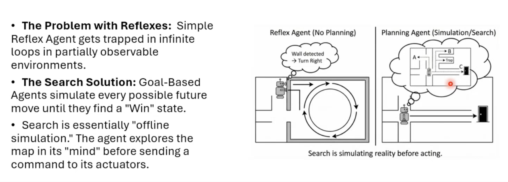
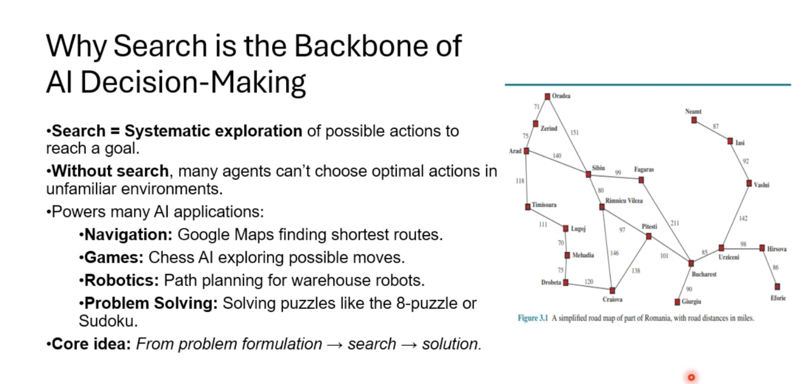
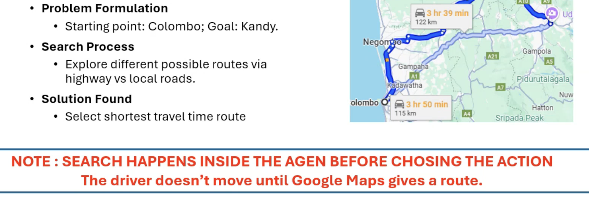
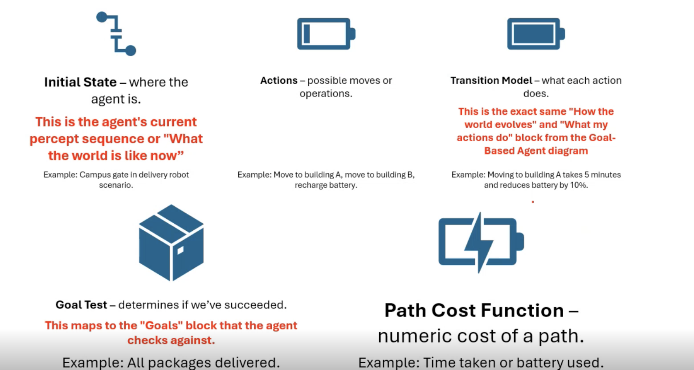
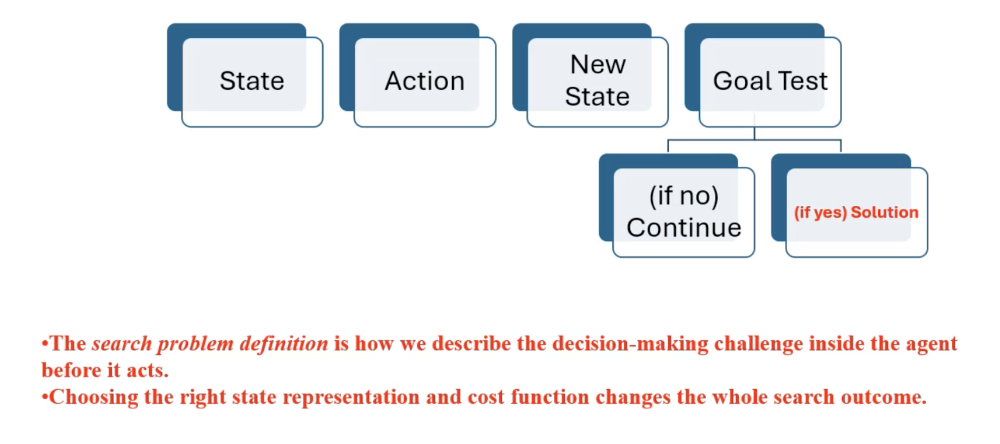
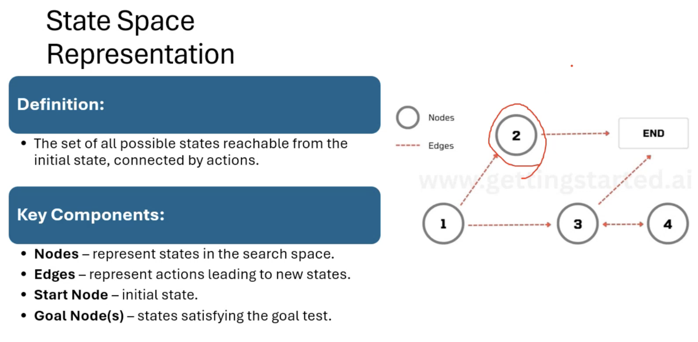
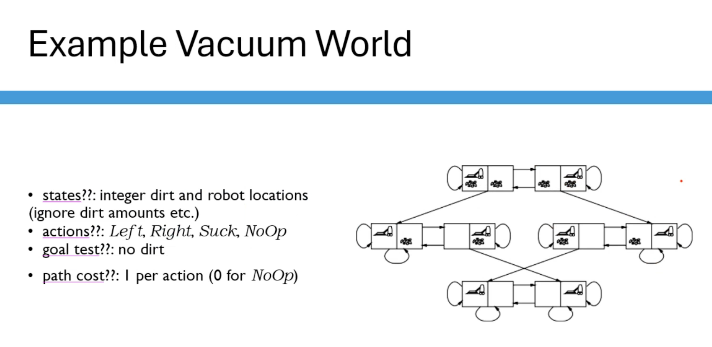
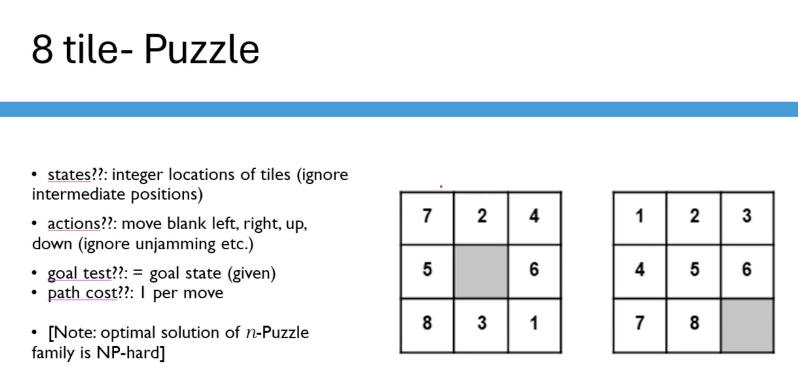

# Searching Algorythms

AI search algorithms are `Systematic problem-solving methods used by intelligent agents to navigate through a "problem space" from an initial state to a desired goal state`

 

## Why Searching Algos

 

## Searching Methods

There are 2 main types of Search Problems depend on the Era

- [Classical Searching Types](./classical_search.md)
- [Modern Searching Types](./modern-search.md)

 

## Formalize a Search Problem

 

 

 

 

 

## Requirements of Search Algorythms

- Should have a `motion` / `state change`
- Should be a `systamatic` / `step by step` approach
